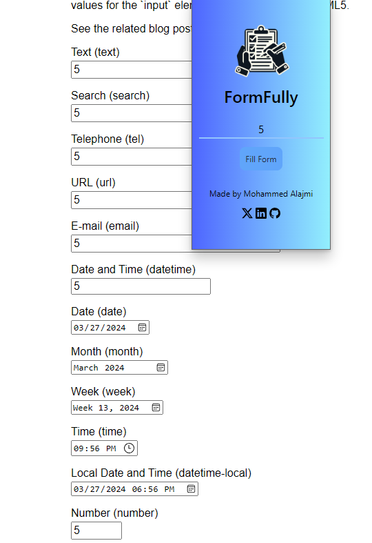

<div align="center">
	
	<h1>FormFully</h1>
	<p>A browser extension that fills web forms in one click, in English or Arabic.</p>
	<a href="https://formfully.mohammed.win/" target="_blank">Website</a>
	·
	<a href="https://chromewebstore.google.com/detail/formfully/ojlpggfkjhgadcjdmkgdmpilhmnghlmj" target="_blank">Chrome Web Store</a>
	·
	<a href="https://microsoftedge.microsoft.com/addons/detail/formfully/giahhadiaaljamhigkeggghcadfnofce" target="_blank">Edge Add-ons</a>
	·
	<a href="https://buymeacoffee.com/devm7mdali" target="_blank">Support</a>
</div>

---

## Overview

FormFully fills web forms for you, which is mostly useful when you test forms or fill the same ones often. It has two modes:

- **Classic** is the original behavior and is still the default. It fills every field with one value.
- **Smart** is opt-in. It fills Google Forms and regular web forms from a saved profile: names, email, phone, company, address, common field types, textareas, selects, and custom choice controls.

Website: [formfully.mohammed.win](https://formfully.mohammed.win/)

## Features

- Classic mode fills every field with one value. Leave the value blank to get a random number from 1 to 5 per field.
- Classic mode picks a random option in each unanswered radio group.
- Date and color fields get valid values: `date`, `month`, `week` (ISO week), `time`, and `datetime-local` use the current date or time, and `color` gets a random hex.
- Smart mode recognizes full, first, and last name, email, phone, company, address, city, country, URL, job title, and more.
- Custom field rules such as `Group number → 12`. When several rules match, the most specific one wins.
- Fills inputs, textareas, native selects, contenteditable fields, radio groups, checkbox questions, and custom ARIA controls.
- Fires native `input` and `change` events, so React and other controlled form libraries pick up the values.
- Smart mode keeps existing answers and skips passwords, file uploads, payment and security fields, consent and marketing checkboxes, and submit buttons.
- English and Arabic interface with right-to-left layout. The language switches instantly.
- Your value and settings live in the browser's local extension storage, shared by the popup and the shortcut.
- Keyboard shortcut: `Alt + Shift + F` on Windows and Linux, `Option + Shift + F` on macOS. You can change it.
- Plain JavaScript and Tailwind, no UI framework.

## Keyboard shortcut

The default is `Alt + Shift + F` on Windows and Linux, and `Option + Shift + F` on macOS.

The extension still registers the old `fill-form-alt` command ID. Browsers remember shortcut assignments by command ID, so removing it would break Option + Shift + F for existing macOS users.

To change the shortcut in Chrome or Edge, open `chrome://extensions/shortcuts`. In Firefox, use **Manage Extension Shortcuts** in `about:addons`. The popup's shortcut dialog shows the default for your platform.

## Languages

| Language | Direction |
|----------|-----------|
| English  | LTR       |
| العربية  | RTL       |

The popup remembers your language in localStorage and switches text direction and fonts right away.

## How values are chosen

### Classic mode

| Input type | Value |
|------------|-------|
| text / number (you set a value) | Your value |
| text / number (blank) | Random integer from 1 to 5 |
| date | Today (YYYY-MM-DD) |
| month | Current month (YYYY-MM) |
| week | ISO week (YYYY-Www) |
| time | Current time (HH:MM) |
| datetime / datetime-local | Current date and time (YYYY-MM-DDTHH:MM) |
| color | Random hex `#RRGGBB` |

Classic mode also keeps the `a_next` click behavior that some older workflows rely on.

### Smart mode

Smart mode looks at the field type, `autocomplete`, name and id, placeholder, ARIA attributes, the associated label, nearby question text, and English and Arabic keywords. Your profile is saved locally. Blank profile items get a safe demo value, and general questions use the optional "Default answer".

For unusual fields, add a custom rule with the field's visible label (or a keyword in it) and the value you want. Rules are saved locally and win over Smart mode's own guess. They also pick matching options in dropdowns, radio groups, and checkbox questions.

Smart mode never submits a form or moves to the next page, and it doesn't change answers that are already filled in.

## Installation

### From the stores

* Chrome: [Install](https://chromewebstore.google.com/detail/formfully/ojlpggfkjhgadcjdmkgdmpilhmnghlmj)
* Edge: [Install](https://microsoftedge.microsoft.com/addons/detail/formfully/giahhadiaaljamhigkeggghcadfnofce)

### For development

These commands open a separate browser with the extension loaded:

```bash
pnpm dev:extension          # Chrome (default)
pnpm dev:extension:chrome
pnpm dev:extension:firefox
```

Each one builds the right target and uses a temporary browser profile, so your normal Chrome or Firefox profile isn't touched. Press `Ctrl+C` to stop it.

To load the extension into your own browser profile:

1. Clone the repository.
2. Run `pnpm install`.
3. Run `pnpm build:extension`.
4. Load the build for your browser:
   - Chrome or Edge: turn on Developer Mode at `chrome://extensions`, click **Load unpacked**, and select `apps/extension/dist/chrome`.
   - Firefox: open `about:debugging#/runtime/this-firefox`, click **Load Temporary Add-on**, and select `apps/extension/dist/firefox/manifest.json`.
   - Safari: run `xcrun safari-web-extension-converter apps/extension/dist/safari --macos-only`, then build the generated project in Xcode.

## Usage

1. Click the FormFully icon to open the popup.
2. Leave **Classic** selected for the one-value behavior, or switch to **Smart**.
3. In Classic, enter a value or leave it blank for random values.
4. In Smart, add your name, email, phone, company, and other details if you want.
5. Click the fill button or press `Alt + Shift + F`.

The shortcut uses whichever mode is selected in the popup.

## Screenshot

<div align="center">
	
</div>

## Permissions and privacy

| Permission | Why |
|------------|-----|
| `activeTab` | Run the fill script on the current page when you ask |
| `scripting` | Run the fill function (required by Manifest V3) |
| `storage` | Save the selected mode, Classic value, Smart profile, and custom rules |

The extension makes no network requests and has no analytics or trackers. Classic values, your Smart profile, and custom rules stay in the browser's local extension storage on your device.

## Tech stack

* Manifest V3 for Chrome, Edge, Firefox, and Safari
* Strict TypeScript compiled to plain JavaScript
* Tailwind CSS, plus a few custom component classes
* A small typed i18n dictionary in the repo
* React, Vite, and TypeScript for the landing page
* Nx for running tasks and caching, on top of pnpm workspaces with one lockfile

## Repository structure

```text
apps/
  extension/      Nx project `extension`: browser extension source, tests, and manifest
  landing-page/   Nx project `landing-page`: React landing page and hosting configuration
tooling/          Nx project `tooling` (an implicit dependency of `extension`)
  extension/      Multi-browser build, manifest, and packaging tools
  release/        Chrome and Edge publishing clients
  tests/          Release automation tests
docs/             Maintainer documentation
nx.json           Shared Nx inputs, cache, and target defaults
```

Each project defines its targets in its own `project.json`. The root scripts call Nx, which runs tasks in dependency order (`test`, `lint`, and `package` build the extension first) and restores unchanged results from the local cache.

Common commands:

| Command | Purpose |
| --- | --- |
| `pnpm install` | Install the whole workspace from one lockfile |
| `pnpm dev:extension` | Build and open FormFully in a separate Chrome profile |
| `pnpm dev:extension:firefox` | Build and open FormFully in a separate Firefox profile |
| `pnpm typecheck` | Type-check both apps and the release tooling |
| `pnpm test` | Build the extension and run all tests |
| `pnpm build` | Build the extension and the landing page |
| `pnpm package:extension` | Create versioned Chrome, Firefox, and Safari ZIPs with checksums |
| `pnpm lint:firefox` | Check the Firefox build with Mozilla's add-on linter |
| `pnpm check` | Run the same checks and packaging as CI |
| `pnpm affected` | Type-check, lint, test, and build only projects changed since `main` |
| `pnpm graph` | Open the Nx project graph |
| `pnpm nx run <project>:<target>` | Run one target, for example `pnpm nx run extension:build safari` |

## Contributing

1. Fork the repo and create a feature branch.
2. Make your changes. Keep the popup small and fast.
3. If you add text users will see, update the README and both languages in i18n.
4. Open a PR that explains why, with screenshots in English and Arabic for visual changes.

Some ideas: configurable presets, per-domain profiles, a side panel, and an options page for advanced patterns.

## Browser builds

`apps/extension/manifest.base.json` holds the shared Manifest V3 metadata. The build adds only the background and compatibility keys each browser needs:

| Target | Development build | Release package |
| --- | --- | --- |
| Chrome and Edge | `apps/extension/dist/chrome` | `artifacts/formfully-chrome-<version>.zip` |
| Firefox | `apps/extension/dist/firefox` | `artifacts/formfully-firefox-<version>.zip` |
| Safari | `apps/extension/dist/safari` | `artifacts/formfully-safari-<version>.zip` |

Firefox and Safari use an event-page background script. Chrome and Edge use a service worker. Runtime API calls use the promise-based `browser` namespace when it exists and fall back to Chromium's `chrome` namespace.

## Store releases

After each successful verification on `main`, semantic-release reads the conventional commits. The first release keeps the manifest version. After that, `fix:` commits make a patch release, `feat:` a minor release, and `BREAKING CHANGE:` a major release. Each GitHub Release includes checksummed ZIPs for Chrome/Edge, Firefox, and Safari.

Publishing to the Chrome Web Store and Microsoft Edge Add-ons is a separate workflow. For a release made by CI, run **Publish browser extension** by hand and pick the store. A tag you push yourself must match the manifest version exactly, for example `v2.3.0`.

Every branch and pull request runs commit validation and the same verification pipeline, and uploads the three ZIPs as workflow artifacts. The landing page deploys only after `Verify` passes on `main`, and it deploys that exact commit.

Setup, required secrets, release steps, retries, and safety checks for maintainers are in [Browser store release automation](./docs/store-release.md).

## Changelog highlights

| Version | Summary |
|---------|---------|
| 2.2.0 | Added saved Smart custom-field rules and random Classic radio-group selection |
| 2.1.0 | Added opt-in Smart mode for Google Forms and general forms. Classic stayed the default and didn't change |
| 2.0.2 | Shortcut dialog with per-platform details, simpler command, smaller footer |
| 2.0.1 | Added the keyboard shortcut, a background service worker, and storage migration |
| 2.0.0 | Redesign with a glass UI, Arabic (RTL) support, presets, i18n extraction, and a donation button |
| 1.x   | First version: a small popup and basic filling |

## Support

If FormFully saves you time, you can [buy me a coffee](https://buymeacoffee.com/devm7mdali).

## License

MIT. See [LICENSE](./LICENSE).

---
Made by [Mohammed Alajmi](https://devm7mdali.github.io) for testers, QA engineers, and developers.
